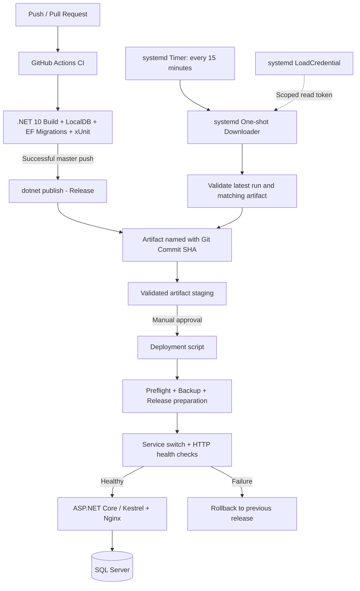

# LoginExample — CI/CD & Deployment Engineering

> A practical DevOps implementation for an ASP.NET Core MVC application, focusing on automated quality gates, traceable release artifacts, controlled deployments, and failure recovery.
>
> **Scope:** Automated CI and artifact retrieval; **production deployment is intentionally approval-based**. This is not a push-to-production pipeline.

## Overview

LoginExample is built with **.NET 10 / ASP.NET Core MVC**, **Entity Framework Core**, **ASP.NET Core Identity**, and **SQL Server**. Its delivery workflow separates application validation from the decision to release a version.

The workflow has been implemented and exercised end-to-end: GitHub Actions publishes a versioned artifact; a Linux-side job retrieves validated artifacts; a separate deployment pipeline backs up the running release, prepares and activates a candidate, performs HTTP health checks, and attempts rollback on failure.

## Architecture



## Implemented capabilities

| Area | Implementation | Verified |
|---|---|---|
| Continuous Integration | GitHub Actions triggered by pushes and pull requests to `master` | Yes |
| Build and tests | Restore, build, start isolated SQL Server LocalDB, apply EF Core migrations, run xUnit integration tests | Yes |
| Release artifact | Release publish after successful tests; artifact name includes the Git commit SHA | Yes |
| Artifact hygiene | Checks required files and excludes environment-specific configuration from published output | Yes |
| Artifact discovery | Select the latest relevant CI run; only accept `completed` + `success` | Yes |
| Artifact validation | Verify commit-based name, availability, non-expiration, nonzero archive size, and required staging files | Yes |
| Automated retrieval | Periodic systemd oneshot service downloads artifacts to isolated staging | Yes |
| Credential handling | GitHub fine-grained, read-scoped token supplied via systemd `LoadCredential` | Yes |
| Concurrency protection | `flock` locks for downloader and production deployment pipeline | Yes |
| Controlled deployment | Manual release selection, preflight, backup, versioned release preparation | Yes |
| Release safety | Service-account permission validation, service restart, HTTP checks, automatic rollback attempt | Yes; including failure-path testing |
| Production auto-deploy | Deliberately not enabled | No |

### 1. CI: quality gate before publishing

Workflow: [`.github/workflows/ci.yml`](../.github/workflows/ci.yml)

The pipeline runs on a Windows GitHub Actions runner using .NET 10. The test stage provisions an isolated SQL Server LocalDB database, applies EF Core database migrations, and executes xUnit integration tests. This checks application behavior against a SQL Server-compatible relational environment instead of only compiling the source.

Only a successful push build on the target branch enters the artifact publishing steps. Publication is framework-dependent, using `UseAppHost=false` so the application can run with an installed .NET runtime on Linux.

The resulting artifact is named:

```text
loginexample-linux-<full-git-commit-sha>
```

The artifact is retained for **7 days**. Environment-specific settings (`Development`, `Testing`, `Production`) are not included in the release artifact; production configuration is maintained separately.

### 2. Automated artifact discovery and retrieval

Script: [`DevOps/check-release.sh`](../DevOps/check-release.sh)

The downloader supports two modes:

```bash
bash DevOps/check-release.sh --check     # Inspect the latest eligible CI run
bash DevOps/check-release.sh --download  # Validate and stage its artifact
```

Its safeguards include:

- Selecting the **latest** push run on the target branch; an in-progress or unsuccessful latest run does not cause fallback to an older successful build.
- Checking CI status and conclusion before using the run.
- Matching the artifact name to the reported 40-character commit SHA.
- Rejecting missing, expired, or empty artifacts.
- Downloading to a temporary directory before publishing a staging directory.
- Checking essential application files and disallowing environment-specific configuration files.
- Revalidating required files before skipping an existing staging directory.
- Avoiding concurrent retrieval with an advisory file lock (`flock`).

The scheduled downloader runs as a restricted, non-root user. Authentication uses a repository-scoped GitHub token with read access to Actions metadata/artifacts, delivered via systemd Credentials rather than committed to source control.

### 3. Scheduling and operations

Unit definitions:

- [`DevOps/loginexample-cd.service`](../DevOps/loginexample-cd.service) — systemd `Type=oneshot` downloader.
- [`DevOps/loginexample-cd.timer`](../DevOps/loginexample-cd.timer) — calendar schedule, every 15 minutes, with persistence and small randomized delay.

Typical operations after the units have been installed by an administrator:

```bash
# Inspect the recurring schedule
systemctl status loginexample-cd.timer
systemctl list-timers --all loginexample-cd.timer

# Inspect the last downloader result
systemctl show loginexample-cd.service -p Result -p ExecMainStatus
journalctl -u loginexample-cd.service -n 50 --no-pager

# Manually initiate a retrieval job (does NOT deploy to production)
sudo systemctl start loginexample-cd.service

# Pause / resume automated artifact retrieval
sudo systemctl disable --now loginexample-cd.timer
sudo systemctl enable --now loginexample-cd.timer
```

**Important:** a completed oneshot downloader is normally `inactive`. Its execution result and journal entries determine whether the run succeeded. Disabling the timer affects artifact retrieval, not the running application.

### 4. Deployment, backup, and rollback

Scripts:

- [`DevOps/deploy.sh`](../DevOps/deploy.sh)
- [`DevOps/switch-release.sh`](../DevOps/switch-release.sh)

These scripts implement an operator-controlled release process:

1. Validate the candidate artifact, release identifier, protected configuration, and active application service.
2. Back up the currently deployed release.
3. Prepare a separate versioned release with controlled ownership and file permissions.
4. Verify candidate files **as the actual application service account**, including directory traversal permissions and file readability.
5. Acquire a deployment-wide lock; stop the service and switch directories while preserving the previous version.
6. Restart the application and check local application and reverse-proxy HTTP endpoints.
7. If deployment fails, attempt to restore the previous release and verify its health; preserve the failed release for diagnosis.

The release deployment uses `rsync` with permission handling (`-rltp`, `--chmod`) and excludes production secrets from artifact replacement. Backup and rollback are separate recovery measures; neither provides automatic rollback of non-backward-compatible database schema changes.

### 5. Validation and failure recovery

Validation has included more than successful builds:

- Successful integration testing and Linux-compatible artifact publication.
- Git commit SHA matching between the selected run and artifact.
- Automated artifact retrieval and skip-on-repeat behavior.
- Negative tests for incomplete staging directories and simultaneous download attempts.
- Deliberately corrupted candidate directory permissions, correctly rejected during preflight.
- A real failed deployment where Linux directory permissions prevented a runtime dependency from loading; the previous application release was automatically restored.
- A subsequent successful deployment confirmed by a running application service, **HTTP 200**, and an identical SHA-256 checksum between the deployed application DLL and downloaded artifact.

The permissions failure was traced to missing rsync permission preservation (`-p`), compounded by a restrictive `umask`. Additional preflight validation was added to detect this class of error **before** interrupting the live service.

## Security and operating boundaries

- No database passwords or GitHub tokens are committed to the repository or included in release artifacts.
- GitHub API access uses an expiring, repository-scoped, read-only token supplied through systemd Credentials.
- The artifact downloader does **not** run the production deployment scripts.
- Deployment requires an explicit operator decision and a unique release identifier.
- A successful CI run and artifact checks are necessary gates, **not** a guarantee that every application behavior is correct in production.
- Artifact contents are not yet protected by independently verified signatures or provenance attestations; file-existence checks are not a cryptographic integrity guarantee.

## Current status and future improvements

**Completed:** automated CI, artifact publication, scheduled artifact retrieval, manually approved deployment, basic deployment safeguards, and tested rollback behavior.

**Future work:** approval/audit trail, automated deployed-version tracking, artifact signing/provenance verification, lifecycle cleanup for old staging and backups, credential rotation, and further hardening of deployment and runtime security.

> **Project highlight:** This implementation demonstrates not only how to produce a CI artifact, but also how to operate a real Linux application delivery workflow, diagnose runtime-only failures, recover from unsuccessful releases, and keep production promotion separate from continuous integration.
