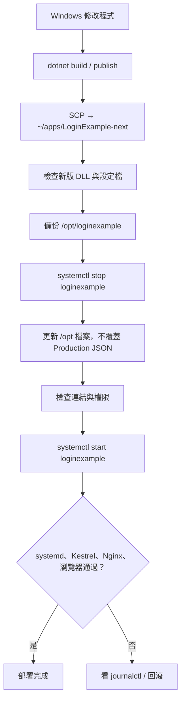

# LoginExample｜Ubuntu 首次部署、再部署與回滾 SOP

> [!abstract] 筆記目的
> 記錄 **Windows 開發 → Ubuntu 26.04.1 部署 ASP.NET Core 10 MVC → SQL Server 2025 → systemd → Nginx** 的實作流程，並整理未來每次修改程式後的 **Publish／SCP／備份／更新／驗收／回滾** SOP。
>
> 依據本專案已執行的步驟整理。以下 IP 與路徑為當時的實驗環境，搬遷時請自行調整。

> [!warning] 安全與適用範圍
> 本筆記是 **VM／學習環境** 的部署紀錄，不等於可直接對公網開放的正式營運設定。**不記錄真實密碼**；SQL Server 使用的 Ubuntu 發行版組合與 `TrustServerCertificate=True` 仍有正式環境風險。HTTPS、憑證驗證與 Forwarded Headers 實際行為驗證尚未全部完成。

## 0. 部署成果與目前進度

| 項目 | 已確認結果 |
|---|---|
| Windows `dotnet build` / Release Publish | 成功 |
| Windows → Ubuntu SSH / SCP | 成功 |
| Ubuntu 執行 .NET 10 Runtime | 成功 |
| Ubuntu SQL Server 2025 / 資料庫 | 成功 |
| EF Core 6 筆 Migration 初始化 | 成功（有 SQL Script 修正事項） |
| ASP.NET Core Identity 註冊、登入 | 成功 |
| Production Admin Bootstrap | 成功（可登入並新增分類） |
| `loginexample` 專屬 Linux 服務帳號 | 完成 |
| `/opt/loginexample` 與 `/etc/loginexample` 權限隔離 | 完成 |
| systemd 自動啟動／Ubuntu 重開機後驗收 | 成功 |
| Nginx HTTP :80 → Kestrel :5000 | 成功 |
| Nginx 站台命名 `loginexample` | 完成 |
| Forwarded Headers `Program.cs` 設定、編譯、再部署 | 已完成，HTTP 200 |
| **Forwarded Headers 原始 IP／Scheme 日誌驗證** | **待完成** |
| HTTPS / 正式 CA 憑證 | 尚未建置 |

**最後已完成的操作：**新版程式重新部署後，`systemctl`、Kestrel `:5000`、Nginx `:80` 與瀏覽器 `/Articles` 均驗收成功。最後討論到暫時加入診斷 Middleware；**目前僅提出修改與編譯步驟，尚未確認該診斷版本已部署並成功記錄真實 IP。**

## 1. 環境與架構

| 元件 | 本次使用版本或路徑 |
|---|---|
| 開發機 | Windows，安裝 .NET SDK，使用 PowerShell |
| Web 專案 | `LoginExample`，ASP.NET Core MVC / .NET 10 |
| Web 驗證及持久化 | ASP.NET Core Identity + EF Core 10 |
| VM | VMware Workstation、Ubuntu 26.04.1 LTS x64 |
| Ubuntu VM IP | `192.168.234.128`（VM NAT，可能改變） |
| Ubuntu .NET Runtime | `Microsoft.NETCore.App 10.0.12`、`Microsoft.AspNetCore.App 10.0.12`；**沒有 SDK** |
| SQL Server | SQL Server 2025 Developer Edition，TCP `1433` |
| SQL 資料庫 | `LoginExampleDb` |
| SQL 應用程式登入 | `loginexample_app` |
| Linux Web 服務帳號 | `loginexample`（無互動式登入） |
| Linux Web 工作目錄 | `/opt/loginexample` |
| Production 設定檔（實體） | `/etc/loginexample/appsettings.Production.json` |
| Production 設定檔（程式看到的路徑） | `/opt/loginexample/appsettings.Production.json` → 符號連結 |
| systemd Unit | `/etc/systemd/system/loginexample.service` |
| Nginx 啟用設定 | `/etc/nginx/sites-enabled/loginexample` |
| Kestrel | `http://127.0.0.1:5000`（僅供本機 Proxy 存取） |
| 對外 HTTP | `http://192.168.234.128/Articles`，Port 80 |

```mermaid
flowchart TD
    A[Windows Browser] -->|HTTP :80| B[Nginx on Ubuntu]
    B -->|HTTP 127.0.0.1:5000| C[ASP.NET Core 10 / Kestrel]
    C -->|EF Core / SQL Auth| D[(SQL Server 2025\nLoginExampleDb)]
    E[systemd: loginexample.service] -.啟動與管理.-> C
    F[/etc/loginexample/appsettings.Production.json] -.權限受控的設定.-> C
```

> [!info] 身分分層
> `loginexample`（Linux 執行帳號）、`loginexample_app`（SQL Login）、網站 Identity 的 `Admin`（Web 使用者角色）是**三種不同的身分**，不可混淆。

## 2. 首次部署總覽

1. Ubuntu 準備 SSH、.NET 10 **Runtime**、SQL Server、Nginx。
2. Windows 編譯／Publish，經由 SCP 上傳程式。
3. SQL Server 建立資料庫、套用 EF Migration、建立最低必要權限的應用程式 SQL Login。
4. 建立 Production 設定，確認應用程式可連線資料庫。
5. 只執行一次 Admin Bootstrap（若需要）。
6. 建立 Linux 專用執行帳號、正式程式目錄、受保護設定檔。
7. 建立並啟用 systemd 服務，測試重開機後自動恢復。
8. 設定 Nginx Reverse Proxy 並驗證 Windows 瀏覽器可以存取。

### 2.1 Ubuntu 基本環境檢查

```bash
# SSH 服務
systemctl is-active ssh

# .NET 10 Runtime（部署端不必安裝 SDK）
dotnet --list-runtimes

# SQL Server 服務
systemctl is-active mssql-server

# Nginx 服務與設定語法
systemctl is-active nginx
sudo nginx -t

# 監聽埠
sudo ss -lntp | grep -E ':(22|80|1433|5000)\b'
```

實際過程中有補上 Ubuntu 缺少的 .NET Runtime，並修正 SQL Server APT 的簽章 keyring（`microsoft-prod.gpg` 與 `signed-by`）問題，最後可正常啟動服務。**當時沒有在本 SOP 中保留每一條安裝指令**；重建時應重新核對 Microsoft 官方支援的 Linux 版本、套件來源與 Runtime 安裝方式，不要直接把 Ubuntu 24.04 的 SQL Server 套件來源當成 Ubuntu 26.04 正式受支援配置。

### 2.2 Windows Publish 與首次上傳

在 Windows PowerShell，切換到 `LoginExample.csproj` 所在目錄：

```powershell
dotnet build
dotnet publish -c Release -o .\publish
```

在 Ubuntu 先建立使用者的上傳目錄：

```bash
mkdir -p ~/apps/LoginExample
```

在 Windows 執行（`<username>` 換成 Ubuntu SSH 帳號）：

```powershell
scp -r .\publish\* <username>@192.168.234.128:~/apps/LoginExample/
```

> [!tip] 為什麼只安裝 Runtime？
> Windows 負責 **Build/Publish**；Ubuntu 負責 **Run**，正式服務只要 ASP.NET Core Runtime，透過 `dotnet LoginExample.dll` 執行。

### 2.3 SQL Server 與 EF Core Migration

在 Ubuntu 確認 SQL Server：

```bash
systemctl is-active mssql-server
sudo ss -lntp | grep ':1433'
```

當時 Ubuntu 沒有安裝 `sqlcmd`，因此使用 **Windows SSMS** 連到 Ubuntu SQL Server 建立資料庫、執行 SQL Script 與驗證。

EF Core Migration（當時已存在的 6 筆）：

1. `20261016104856_InitialIdentiry`
2. `20261017080400_AddArticles`
3. `20261018022515_AddArticleArchive`
4. `20261019031712_AddArticleCategory`
5. `20261019054013_AddCategoryUniquName`
6. `20261020224534_AddCategorySoftDelete`

在 **Windows 開發機（有 .NET SDK 與 dotnet-ef）** 產生從空資料庫開始的 Script：

```powershell
dotnet ef migrations script 0 -o .\LoginExample.fresh.sql
```

> [!danger] 已碰過的 Migration 問題：`Invalid column name 'CategoryId'`
> 在 `AddArticleCategory` 裡，新增欄位後立即用同一 SQL 批次的 `UPDATE [Articles] SET [CategoryId] = 1 ...`，SQL Server 編譯該批次時可能認為新欄位不存在。
>
> 當時的**一次性 SQL Script workaround** 是將該段 UPDATE 調整為動態 SQL，再用 SSMS 執行：
>
> ```sql
> EXEC(N'UPDATE [Articles] SET [CategoryId] = 1 WHERE [CategoryId] IS NULL;');
> ```
>
> **注意：原始 C# Migration 尚未確認已修復。** 日後重新產生從零開始的 SQL Script 時，仍須檢查此段。不要隨意修改已套用的 Migration 或當作所有既有資料庫都能安全重跑。

以 **SQL Server 系統管理員** 在 SSMS 建立資料庫與應用登入（示意語法；請在 SSMS 自行安全輸入密碼，不要把真實密碼存進 Obsidian）：

```sql
-- 首次建庫（確認不存在後才執行）
CREATE DATABASE [LoginExampleDb];
GO

-- 在 master 建立 Server Login（密碼請自行以安全方式輸入）
USE [master];
GO
CREATE LOGIN [loginexample_app]
WITH PASSWORD = '<REPLACE_WITH_STRONG_PASSWORD>';
GO

-- 在應用程式資料庫授予必要權限
USE [LoginExampleDb];
GO
CREATE USER [loginexample_app] FOR LOGIN [loginexample_app];
ALTER ROLE [db_datareader] ADD MEMBER [loginexample_app];
ALTER ROLE [db_datawriter] ADD MEMBER [loginexample_app];
GO
```

**執行順序：**建立空資料庫 → 用管理者在 `LoginExampleDb` 執行修正後的 EF Script → 建立／對應應用程式 SQL 使用者及角色 → 驗證網站 Identity 的 Register/Login 與文章、分類查詢。若 Login 已存在，勿重複 `CREATE LOGIN`；重新建立資料庫時需重新在新資料庫建立 `USER` 對應。

> [!important] Migration 與網站權限分離
> `loginexample_app` 只擁有 `db_datareader` / `db_datawriter`，**不是 `db_owner`**。Schema Migration 用管理者或專門的遷移身分執行，網站執行階段不用高權限帳號。

### 2.4 Production 設定（機密不進版控）

當時以 `appsettings.Production.json` 儲存 SQL Server Connection String，包含應用登入帳密；下例**不是真實帳密**：

```json
{
  "ConnectionStrings": {
    "DefaultConnection": "Server=127.0.0.1,1433;Database=LoginExampleDb;User Id=loginexample_app;Password=<YOUR_SECRET>;Encrypt=True;TrustServerCertificate=True;"
  }
}
```

檢查：

- Connection String key 必須跟 `Program.cs` 使用的名稱一致（此處示範 `DefaultConnection`）。
- Production 環境：`ASPNETCORE_ENVIRONMENT=Production` 與 `DOTNET_ENVIRONMENT=Production`。
- 若 Shell 曾設定 `ConnectionStrings__DefaultConnection`，它的優先順序可能覆蓋 JSON；正式 systemd 服務的環境來源也要一起檢查。
- Zsh 使用特殊字元時，曾遇過 `read -p: no coprocess`、`event not found`；不要把 Bash 指令不加檢查地貼到 Zsh，密碼字串也不要直接貼在命令列或公開日誌。
- `TrustServerCertificate=True` 只作為當時實驗環境的暫時選項；正式環境應使用可信任的憑證鏈。

### 2.5 Production Admin Bootstrap（只在必要時執行一次）

網站正式環境不應讓「第一個註冊使用者」自動成為 Admin。當時採用**明確指定的單次 Bootstrap** 流程：

```bash
cd ~/apps/LoginExample

env \
  ASPNETCORE_ENVIRONMENT=Production \
  DOTNET_ENVIRONMENT=Production \
  LOGINEXAMPLE_BOOTSTRAP_ADMIN=1 \
  SeedAdmin__Email='a@b.c' \
  dotnet LoginExample.dll
```

**使用前提：**該 Email 對應的 Identity 使用者必須先存在，且程式碼包含 `LOGINEXAMPLE_BOOTSTRAP_ADMIN` 分支。這個程式啟動模式會確保 Admin Role 存在、將指定使用者加入角色，接著退出，不作為平常的 Web 啟動模式。當時已用實際登入並新增需要 Admin 權限的 Category 來驗證。

> [!warning]
> 此段 Email 是當時的示例值；不可用它取代自己的實際帳號，也不要將 `LOGINEXAMPLE_BOOTSTRAP_ADMIN=1` 永久加到 systemd Unit。只有使用者確實存在、程式包含 Bootstrap 邏輯且 DB 可連線時才執行。

## 3. 建立正式 Linux 部署結構（首次執行）

### 3.1 建立專用 OS 帳號

```bash
sudo useradd --system --user-group \
  --home-dir /opt/loginexample \
  --no-create-home \
  --shell /usr/sbin/nologin \
  loginexample
```

這是**首次建立**指令；帳號已存在時不要重複新增。

### 3.2 正式程式目錄與部署檔案

```bash
sudo install -d -o root -g loginexample -m 0750 /opt/loginexample

cd ~/apps/LoginExample

tar --exclude='./appsettings.Production.json' -cf - . \
  | sudo tar --no-same-owner -C /opt/loginexample -xf -

sudo chown -R root:loginexample /opt/loginexample
sudo find /opt/loginexample -type d -exec chmod 750 {} +
sudo find /opt/loginexample -type f -exec chmod 640 {} +
```

原則：**root 擁有程式，`loginexample` 群組有執行與讀取權限；Web Process 不需要修改自己的部署檔案。**

### 3.3 將 Production 設定與程式碼分離

```bash
sudo install -d -o root -g loginexample -m 0750 /etc/loginexample

sudo install \
  -o root -g loginexample -m 0640 \
  ~/apps/LoginExample/appsettings.Production.json \
  /etc/loginexample/appsettings.Production.json

sudo ln -s \
  /etc/loginexample/appsettings.Production.json \
  /opt/loginexample/appsettings.Production.json

sudo -u loginexample \
  test -r /opt/loginexample/appsettings.Production.json \
  && echo 'Configuration readable'
```

正常結果：

```text
/opt/loginexample/appsettings.Production.json
  -> /etc/loginexample/appsettings.Production.json
Configuration readable
```

> [!warning] 已有正式部署時不要重跑 `ln -s`
> 這些是**首次部署**步驟；之後再部署應保留現有符號連結，**不能把新的 Production JSON 從 Windows 覆蓋進正式部署目錄**。

### 3.4 使用受限帳號手動驗證（首次）

因為 `/opt/loginexample` 的權限是 `750 root:loginexample`，一般 Ubuntu 使用者未必能 `cd` 進去；使用以下方式以專用帳號啟動：

```bash
sudo -u loginexample env \
  -u ConnectionStrings__DefaultConnection \
  ASPNETCORE_ENVIRONMENT=Production \
  DOTNET_ENVIRONMENT=Production \
  ASPNETCORE_URLS=http://127.0.0.1:5000 \
  sh -c 'cd /opt/loginexample && exec dotnet LoginExample.dll'
```

另外開一個終端：

```bash
curl -s -o /dev/null -w '%{http_code}\n' \
  http://127.0.0.1:5000/Articles
# 預期 200
```

確認後以 `Ctrl+C` 結束手動執行，再改由 systemd 管理。

## 4. systemd：開機啟動與服務管理

Unit 檔案：`/etc/systemd/system/loginexample.service`

```ini
[Unit]
Description=LoginExample ASP.NET Core Application
After=network.target mssql-server.service

[Service]
Type=simple
User=loginexample
Group=loginexample
WorkingDirectory=/opt/loginexample
ExecStart=/usr/bin/dotnet /opt/loginexample/LoginExample.dll
Environment=ASPNETCORE_ENVIRONMENT=Production
Environment=DOTNET_ENVIRONMENT=Production
Environment=ASPNETCORE_URLS=http://127.0.0.1:5000
Restart=on-failure
RestartSec=5
NoNewPrivileges=true

[Install]
WantedBy=multi-user.target
```

建立／修改後執行：

```bash
sudo systemd-analyze verify /etc/systemd/system/loginexample.service
sudo systemctl daemon-reload
sudo systemctl start loginexample
sudo systemctl enable loginexample

systemctl is-active loginexample
systemctl is-enabled loginexample
sudo journalctl -u loginexample -n 30 --no-pager
```

驗證重開機自動恢復：

```bash
sudo reboot
```

Ubuntu 回來後：

```bash
systemctl is-active loginexample
systemctl is-active mssql-server
curl -s -o /dev/null -w '%{http_code}\n' \
  http://127.0.0.1:5000/Articles
```

> [!note] systemd `After=` 的意思
> `After=mssql-server.service` 只規定**兩個服務都啟動時的順序**，不保證主動拉起 SQL Server，也不保證資料庫完全 Ready。本專案重開機驗收已通過；若日後發現冷開機偶發失敗，應另外處理 SQL 可用性、啟動相依與應用重試，而不是誤以為 `After=` 已保證 DB Ready。

## 5. Nginx Reverse Proxy

設定檔：`/etc/nginx/sites-available/loginexample`

```nginx
server {
    listen 80;
    server_name _;

    location / {
        proxy_pass http://127.0.0.1:5000;
        proxy_http_version 1.1;

        proxy_set_header Host $host;
        proxy_set_header X-Real-IP $remote_addr;
        proxy_set_header X-Forwarded-For $proxy_add_x_forwarded_for;
        proxy_set_header X-Forwarded-Proto $scheme;
    }
}
```

當時發現舊站台已存在：

```text
/etc/nginx/sites-enabled/webapplication2
  -> /etc/nginx/sites-available/webapplication2
```

舊站台已經是 `listen 80` 並 Proxy 到 `127.0.0.1:5000`，因此**無須重新設計反向代理，只做命名整理**：

```bash
# 當時執行一次：複製既有設定
sudo cp -a /etc/nginx/sites-available/webapplication2 \
  /etc/nginx/sites-available/loginexample

# 保留舊啟用連結以備還原
sudo mv /etc/nginx/sites-enabled/webapplication2 \
  /etc/nginx/webapplication2.enabled.bak

# 啟用新名稱
sudo ln -s /etc/nginx/sites-available/loginexample \
  /etc/nginx/sites-enabled/loginexample

sudo nginx -t
sudo systemctl reload nginx
```

> [!warning] 上述為歷史一次性操作
> 現在 `loginexample` **已經啟用**。日後重新部署程式**不需要重複建立 Nginx 連結，也不需要重啟 Nginx**。只有 Nginx 設定本身變更時，才執行 `nginx -t` 及 `systemctl reload nginx`。

驗收：

```bash
# 直接 Kestrel
curl -s -o /dev/null -w '%{http_code}\n' \
  http://127.0.0.1:5000/Articles

# 經過 Nginx
curl -s -o /dev/null -w '%{http_code}\n' \
  http://127.0.0.1/Articles
```

從 Windows 瀏覽器：`http://192.168.234.128/Articles`。

> [!note] `server_name _;`
> `_` 只是名稱，不是 Nginx 特殊萬用字元。哪個 Server Block 回應未匹配 Host，還與 `listen` / `default_server` 及其他站台配置有關。

---

# 6. 日常再部署 SOP（最常用）

> [!success] 適用情境
> 日常修改 Controller / Service / Razor View / `Program.cs` / NuGet 套件後，要更新既有 Ubuntu 服務；**不包括有破壞性 DB Schema Migration 的部署**。若包含 Migration，先規劃資料庫備份與遷移相容性，再更新程式。

## 6.1 流程速覽



## 6.2 Windows：編譯與 Publish

在專案目錄：

```powershell
dotnet build
dotnet publish -c Release -o .\publish
```

確認 `publish\LoginExample.dll` 存在。**如果有整合測試，應於 Publish 前一併執行。**

## 6.3 Ubuntu：準備乾淨的新版暫存目錄

登入 Ubuntu，使用目前 SSH 帳號執行（**不要在 `/opt/loginexample` 或 `/etc/loginexample` 操作**）：

```bash
# 只清理指定的「個人上傳暫存目錄」，避免殘留上次發布的舊檔案
rm -rf -- "$HOME/apps/LoginExample-next"
mkdir -p "$HOME/apps/LoginExample-next"
```

在 Windows PowerShell 上傳：

```powershell
scp -r .\publish\* <username>@192.168.234.128:~/apps/LoginExample-next/
```

在 Ubuntu 檢查：

```bash
ls -lh ~/apps/LoginExample-next/LoginExample.dll
```

## 6.4 Ubuntu：先備份舊版（每次部署都要）

```bash
sudo install -d -m 0700 /var/backups/loginexample

# 檔名帶時間，避免覆蓋前一次備份
BACKUP="/var/backups/loginexample/before-deploy-$(date +%Y%m%d-%H%M%S).tar.gz"
sudo tar -C /opt -czf "$BACKUP" loginexample

echo "Backup: $BACKUP"
sudo ls -lh "$BACKUP"
```

備份包含 `/opt/loginexample` 下的程式及 **Production 設定的符號連結**，但不是 `/etc/loginexample` 內的秘密檔案內容。**如果本次也要修改 Production 設定或資料庫，必須另外規劃各自的備份。**

## 6.5 Ubuntu：停止、更新、確認權限

```bash
sudo systemctl stop loginexample
systemctl is-active loginexample   # 預期 inactive
```

以下指令只把新版 Publish 更新至正式目錄，**排除 Production JSON**：

```bash
cd ~/apps/LoginExample-next

tar --exclude='./appsettings.Production.json' -cf - . \
  | sudo tar --no-same-owner -C /opt/loginexample -xf -

sudo chown -R root:loginexample /opt/loginexample
sudo find /opt/loginexample -type d -exec chmod 750 {} +
sudo find /opt/loginexample -type f -exec chmod 640 {} +
```

> [!warning] 關於「覆蓋更新」
> 這是本次**實際採用**的部署方式；它覆蓋同名檔案，**不會自動刪除舊版已不存在的檔案**。若未來發現舊版 DLL / 靜態資源殘留影響執行，應改採**全新 Release 目錄 + 切換指標**的部署策略，而非貿然對 `/opt/loginexample` 執行 `rm -rf`。

## 6.6 驗證 Production 設定未遭破壞

```bash
ls -l /opt/loginexample/appsettings.Production.json

sudo -u loginexample \
  test -r /opt/loginexample/appsettings.Production.json \
  && echo 'Configuration readable'
```

正確：

```text
appsettings.Production.json -> /etc/loginexample/appsettings.Production.json
Configuration readable
```

可再檢查 DLL 已更新：

```bash
ls -lh /opt/loginexample/LoginExample.dll
```

## 6.7 啟動與四層驗收

```bash
sudo systemctl start loginexample
systemctl is-active loginexample       # active

sudo journalctl -u loginexample -n 30 --no-pager

# 第一層：直接 Kestrel
curl -s -o /dev/null -w '%{http_code}\n' \
  http://127.0.0.1:5000/Articles

# 第二層：Nginx → Kestrel
curl -s -o /dev/null -w '%{http_code}\n' \
  http://127.0.0.1/Articles

# 第三層：資料庫（/Articles 正常顯示內容；必要時操作登入或文章功能）
# 第四層：Windows 瀏覽器開啟 http://192.168.234.128/Articles
```

驗收表（複製一份至每次部署紀錄）：

- [ ] Windows `dotnet build` 成功
- [ ] `dotnet publish` 成功
- [ ] 新版 DLL 上傳成功
- [ ] 舊版備份檔存在且路徑已記下
- [ ] systemd `active`
- [ ] Production 設定符號連結仍有效
- [ ] 服務帳號可讀取 Production 設定
- [ ] Kestrel `/Articles` → HTTP 200
- [ ] Nginx `/Articles` → HTTP 200
- [ ] Windows 瀏覽器畫面正確
- [ ] 日誌無未處理例外或資料庫連線錯誤

> [!important] HTTP 200 的侷限
> 只能代表指定路由可回應，不保證登入、權限、所有 DB 操作、Forwarded Headers 或安全設定都正確。影響驗證／資料庫的改動要另外做功能驗收。

---

## 7. 部署失敗：問題排查與回滾

### 7.1 先檢查錯誤來源

```bash
systemctl status loginexample --no-pager
sudo journalctl -u loginexample -n 100 --no-pager
systemctl is-active mssql-server
sudo ss -lntp | grep -E ':(80|1433|5000)\b'

# Nginx 配置語法；如果是 Nginx 問題再檢查
sudo nginx -t
```

常見檢查重點：

| 問題 | 先檢查 |
|---|---|
| `loginexample` 無法啟動 | `journalctl`、DLL 是否完整、Runtime 是否匹配 |
| HTTP 502 | Kestrel 是否 active / 正在監聽 :5000 |
| SQL Login failed | Connection String、Login / User 對應、DB 權限 |
| 找不到 Production 設定 | `/opt` 符號連結、`/etc` 權限 |
| 連線仍使用舊 Connection String | 環境變數是否蓋過 Production JSON |
| 編譯通過但行為錯 | Razor / DLL 版本、舊檔殘留、環境差異 |

### 7.2 回滾到備份的程式版本

> [!danger] 先決條件
> 這個方式還原**應用程式檔案**，不會回復 SQL Server 內資料或 Migration。若新版程式已改資料庫 Schema／資料，必須先評估舊版程式是否仍相容。請確認備份檔案的路徑存在，且選對版本。

假設備份檔為 `/var/backups/loginexample/before-deploy-YYYYMMDD-HHMMSS.tar.gz`：

```bash
sudo systemctl stop loginexample

# 留下目前失敗版本供檢查，不直接覆蓋它
sudo mv /opt/loginexample \
  "/opt/loginexample.failed-$(date +%Y%m%d-%H%M%S)"

# 將 <實際備份檔名> 換成先前輸出的正確名稱
sudo tar -C /opt -xzf \
  /var/backups/loginexample/<實際備份檔名>.tar.gz

# 驗證連結仍指向 /etc 下的 Production 設定
ls -l /opt/loginexample/appsettings.Production.json
sudo -u loginexample \
  test -r /opt/loginexample/appsettings.Production.json \
  && echo 'Configuration readable'

sudo systemctl start loginexample
systemctl is-active loginexample
curl -s -o /dev/null -w '%{http_code}\n' \
  http://127.0.0.1/Articles
```

> [!tip] 為什麼先 `mv` 失敗版本？
> 若直接解壓覆蓋，失敗版本新增的檔案可能殘留。先將失敗目錄移走，備份才能完整復原成原本的目錄內容。

## 8. Forwarded Headers：已部署、待做行為驗收

Nginx 已有：

```nginx
proxy_set_header X-Forwarded-For $proxy_add_x_forwarded_for;
proxy_set_header X-Forwarded-Proto $scheme;
```

`Program.cs` 已設定信任 loopback Proxy 並啟用 Middleware（示意為當時新增內容）：

```csharp
using Microsoft.AspNetCore.HttpOverrides;
using System.Net;

// 在 var app = builder.Build(); 之前：
builder.Services.Configure<ForwardedHeadersOptions>(options =>
{
    options.ForwardedHeaders =
        ForwardedHeaders.XForwardedFor |
        ForwardedHeaders.XForwardedProto;

    options.KnownProxies.Add(IPAddress.Loopback);
    options.KnownProxies.Add(IPAddress.IPv6Loopback);
    options.ForwardLimit = 1;
});

// 在 HTTPS Redirect / Routing / Authentication 之前：
app.UseForwardedHeaders();
```

**已確認：**上述修改成功編譯、Publish、上傳、重新部署，Nginx → Kestrel → DB 的一般網站請求仍成功。

**尚未確認：**透過 Nginx 進來的 Request，`RemoteIpAddress` 真的變成 Windows 用戶端 IP，`Request.Scheme` 也符合原始請求。

可以在 `app.UseForwardedHeaders();` **後方**暫時加入：

```csharp
app.Use(async (context, next) =>
{
    if (context.Request.Path == "/Articles")
    {
        app.Logger.LogInformation(
            "[ForwardedHeadersCheck] RemoteIP={RemoteIP}, Scheme={Scheme}",
            context.Connection.RemoteIpAddress,
            context.Request.Scheme);
    }

    await next();
});
```

依第 6 節 SOP 重新部署診斷版本後，**由 Windows 瀏覽器經 Nginx Port 80 觸發 `/Articles`**，再在 Ubuntu 查：

```bash
sudo journalctl -u loginexample --since '10 minutes ago' \
  --no-pager | grep ForwardedHeadersCheck
```

預期：`RemoteIP` 是**實際 Windows 用戶端 IP**、`Scheme=http`。透過 Ubuntu 自己的 `curl 127.0.0.1` 無法代替 Windows 外部請求的來源 IP 驗證。

> [!warning]
> 診斷成功後**移除暫時 Log Middleware，再部署一次**，避免長期記錄不必要的用戶端 IP。`ForwardedHeadersOptions` 與 `UseForwardedHeaders()` 則保留。

## 9. 已知技術債與後續工作

- [ ] **EF Migration 原始碼修正**：`AddArticleCategory` 的 `CategoryId` UPDATE 問題。已套用資料庫應先評估 Migration History，不應盲目重跑。
- [ ] **Forwarded Headers 真實行為驗證**：從 Windows 經 Nginx 觸發並查 `RemoteIP` / `Scheme`。
- [ ] **HTTPS**：取得／配置適當憑證，確認反向代理與 ASP.NET Core HTTPS Redirect 行為；目前 VM 僅 HTTP，不能視為公網正式站台。
- [ ] **SQL TLS 憑證**：正式環境不應長期依賴 `TrustServerCertificate=True`。
- [ ] **秘密管理**：現階段 `/etc/loginexample` 權限控管 JSON，未來考慮 systemd Credentials 或專門的 Secret 管理方案；清查 `~/apps/LoginExample/` 殘留的 Production JSON 備份。
- [ ] **資料庫備份**：建立 SQL Server 正式備份／還原演練；單備份 `/opt` **不能**救回資料庫資料。
- [ ] **Deploy 策略改善**：採 Release Directory + atomic symlink switch，解決覆蓋式部署殘留舊檔案問題，縮短服務停止時間。
- [ ] **可靠性與監控**：health endpoint、結構化日誌、SQL Server 啟動相依／Retry、例外警報。
- [ ] **服務安全性**：視功能需求補上更嚴格的 systemd sandboxing 設定；檢查更新頻率與套件支援期限。

## 10. 指令速查

| 需求 | 指令 |
|---|---|
| 查 Web 服務 | `systemctl status loginexample --no-pager` |
| 停止 Web | `sudo systemctl stop loginexample` |
| 啟動 Web | `sudo systemctl start loginexample` |
| 重啟 Web | `sudo systemctl restart loginexample` |
| Web 開機啟動 | `sudo systemctl enable loginexample` |
| 最近 Web 日誌 | `sudo journalctl -u loginexample -n 100 --no-pager` |
| 查 SQL Server | `systemctl is-active mssql-server` |
| 檢查 Nginx | `sudo nginx -t` |
| Reload Nginx | `sudo systemctl reload nginx` |
| 查啟用站台 | `ls -l /etc/nginx/sites-enabled/` |
| 查埠口 | `sudo ss -lntp \| grep -E ':(80\|1433\|5000)\\b'` |
| Kestrel 測試 | `curl -I http://127.0.0.1:5000/Articles` |
| Nginx 測試 | `curl -I http://127.0.0.1/Articles` |
| 正式程式目錄 | `/opt/loginexample` |
| 正式設定目錄 | `/etc/loginexample` |
| 備份目錄 | `/var/backups/loginexample` |

---

**關鍵原則：** `Build → Publish → Upload → Backup → Stop → Update（保留設定）→ Start → Verify → 必要時 Rollback`。
