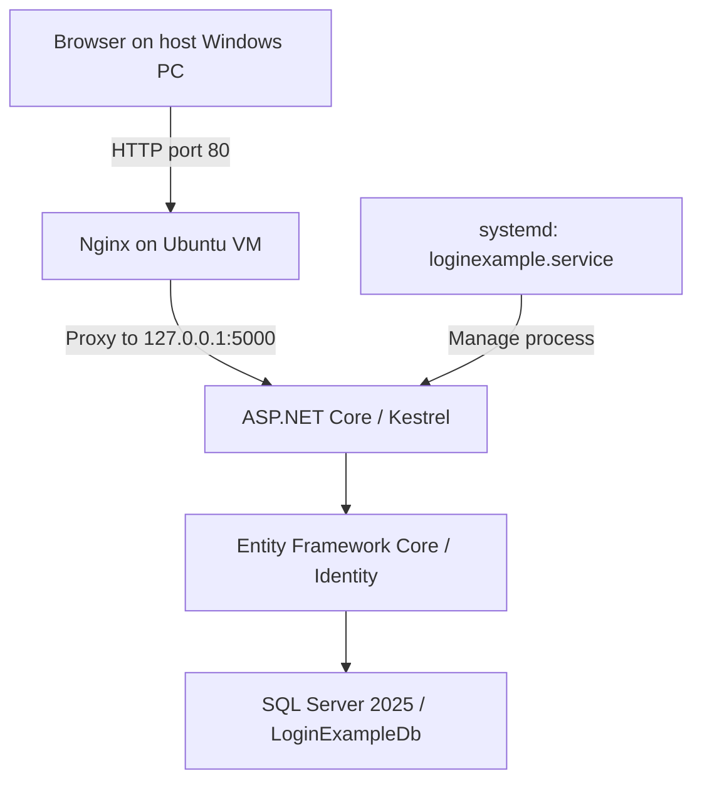

# LoginExample

An ASP.NET Core MVC application built with .NET 10, Entity Framework Core, ASP.NET Core Identity, and Microsoft SQL Server. Developed on Windows and deployed to an Ubuntu virtual machine with Nginx and systemd.

LoginExample is a backend development project focused on implementing authentication, authorization, article and category management, data integrity, and secure web application practices.

The project is developed incrementally, with an emphasis on application behavior, database operations, testing, maintainability, and repeatable deployment.

**Portfolio demo:** The application is running in a local Ubuntu VM; no publicly accessible demo URL is provided. The source code, architecture, and deployment runbook document the implementation.

## Tech Stack

| Category | Technology |
|---|---|
| Framework | ASP.NET Core MVC (.NET 10) |
| Language | C# |
| ORM | Entity Framework Core |
| Database | Microsoft SQL Server |
| Authentication | ASP.NET Core Identity |
| Authorization | Role-based and resource ownership authorization |
| Frontend | Razor Views, Bootstrap |
| Testing | xUnit, ASP.NET Core Integration Testing |
| Version Control | Git |
| Development Environment | Windows, SQL Server Express LocalDB |
| Deployment Environment | Ubuntu 26.04.1 VM, .NET 10 runtime, SQL Server 2025 |
| Web Hosting | Kestrel, Nginx reverse proxy, systemd |

## Features

### Authentication & Authorization

- User registration and login
- Authentication using ASP.NET Core Identity
- Role-based authorization with Admin privileges
- Resource ownership authorization for article operations
- Anti-forgery protection for state-changing HTTP requests
- Server-side validation of user input

### Article Management

- Create articles with category selection
- Edit articles owned by the authenticated user
- Display published articles
- Display article authors and category information
- View article details
- Archive published articles
- View personal archived articles
- Restrict article editing and archiving to authorized owners

### Category Management

- Admin-only category creation, editing, deletion, and restoration
- Category listing for authenticated users
- Category soft deletion using `IsDeleted` and `DeletedAt`
- Restore deleted categories without restoring previous article associations
- Database-level unique category name constraint
- Reserved system category: `未分類` (ID: 1)
- Automatic reassignment of articles to the system category when a category is deleted
- Transaction-based data consistency for category deletion
- Prevention of editing soft-deleted categories

### User Interface

- Shared navigation layout
- Navigation items based on authentication state
- Category management interface for administrators
- Article edit and archive controls based on ownership
- Article author and category display

## Architecture

The application follows the ASP.NET Core Model-View-Controller (MVC) pattern.

### Project Components

| Component | Responsibility |
|---|---|
| Models | Entity definitions and domain data |
| ViewModels | Input validation and view-specific data |
| Controllers | HTTP request processing, authorization, and application logic |
| Views | Razor-based user interface |
| Data | Entity Framework Core DbContext and entity relationships |
| Migrations | Database schema version management |
| Tests | Automated verification of selected application behaviors |

### Data Access

Entity Framework Core is used to interact with Microsoft SQL Server.

The application uses `ApplicationDbContext`, which inherits from `IdentityDbContext`, allowing Identity and application entities to share the same database context.

Application entities include:

- `Article`
- `Category`

Identity provides user and role management through the corresponding Identity entities and tables.

### Article and Category Relationship

Each article belongs to one category.

When an administrator soft-deletes a category:

1. The application begins a database transaction.
2. Articles belonging to that category are reassigned to the reserved `未分類` category.
3. The original category is marked as deleted.
4. The transaction is committed if all operations succeed.

If a database operation fails, the transaction is rolled back.

Restoring a deleted category makes the category available again but does not automatically restore its previous article associations.

## Deployment Architecture

The current deployment is a **local VM demonstration environment**, not a publicly hosted production service.



### Environment and Service Design

- The application is published on Windows using `dotnet publish -c Release` and copied to the VM using SSH/SCP.
- Published application files are deployed under `/opt/loginexample`, with the application run by a dedicated, non-login Linux service account.
- Production configuration is stored separately in `/etc/loginexample/appsettings.Production.json` with restricted filesystem permissions and accessed through a symlink. **Credentials are not committed to Git.**
- `loginexample.service` starts the application automatically after VM reboot and supports start/stop/restart via systemd.
- Nginx proxies HTTP requests on port 80 to Kestrel bound to `127.0.0.1:5000`.
- The deployment procedure includes a pre-update backup, a staged file transfer, service restart, and smoke-test checks.
- SQL Server access uses a dedicated application login rather than the server administrator account.

The full initial setup and manual redeployment procedure is documented in [Ubuntu Deployment and Redeployment SOP](DevOps/LoginExample_Ubuntu_部署與再部署_SOP.md).

### Manual Redeployment Summary

Run from the **repository root on Windows**:

```powershell
dotnet test
dotnet publish .\LoginExample\LoginExample.csproj -c Release -o .\publish
```

Then transfer the publish output to a **staging directory** on the Ubuntu VM. Back up the installed application, stop `loginexample.service`, copy only the application publish files into `/opt/loginexample` **without overwriting** the `appsettings.Production.json` symlink, restore appropriate ownership/permissions, and restart the service. Validate the service and both direct Kestrel and Nginx routes:

```bash
systemctl is-active loginexample
curl -s -o /dev/null -w "%{http_code}\n" http://127.0.0.1:5000/Articles
curl -s -o /dev/null -w "%{http_code}\n" http://127.0.0.1/Articles
```

The current workflow is **manual**; it is not a CI/CD pipeline. Refer to the SOP for the ordered commands and backup/rollback instructions, rather than using this summary as an executable script.

## Getting Started

The following instructions describe how to run LoginExample in a local Windows development environment.

### Prerequisites

Install the following dependencies:

- .NET 10 SDK
- Microsoft SQL Server Express LocalDB
- Git
- Entity Framework Core CLI tools (`dotnet-ef`)

Verify the installed .NET SDK:

```powershell
dotnet --version
```

Verify the EF Core CLI:

```powershell
dotnet ef --version
```

If `dotnet-ef` is not installed, install a version compatible with the project's EF Core packages.

For EF Core 10:

```powershell
dotnet tool install --global dotnet-ef --version "10.*"
```

If the tool is already installed, update it when necessary rather than installing it again.

### 1. Clone the Repository

Clone the repository:

```powershell
git clone <repository-url>
cd LoginExample
```

Replace `<repository-url>` with the actual Git repository URL.

Locate the application project directory containing `LoginExample.csproj`.

The following application commands should be executed from that directory unless otherwise specified.

### 2. Configure the Database

The application uses Microsoft SQL Server through Entity Framework Core.

The default local development configuration is:

| Setting | Value |
|---|---|
| SQL Server instance | `(localdb)\MSSQLLocalDB` |
| Database | `LoginExampleDb` |
| Authentication | Windows Integrated Authentication |
| Connection string key | `ConnectionStrings:DefaultConnection` |

The default `appsettings.json` contains:

```json
{
  "ConnectionStrings": {
    "DefaultConnection": "Data Source=(localdb)\\MSSQLLocalDB;Initial Catalog=LoginExampleDb;Integrated Security=True;Connect Timeout=30;Encrypt=True;Trust Server Certificate=False;Application Intent=ReadWrite;Multi Subnet Failover=False"
  }
}
```

Before proceeding, ensure that SQL Server Express LocalDB is installed and accessible.

If another SQL Server instance is used, override `ConnectionStrings:DefaultConnection` using an appropriate local configuration source or environment variable.

For example, ASP.NET Core supports the environment variable:

```text
ConnectionStrings__DefaultConnection
```

Do not commit database passwords, API keys, or other sensitive credentials to source control.

**Note:** SQL Server Express LocalDB is intended for Windows development. Linux deployment requires a compatible SQL Server connection configuration.

### 3. Restore Dependencies

From the application project directory:

```powershell
dotnet restore
```

Build the application:

```powershell
dotnet build
```

### 4. Initialize the Database

The application uses Entity Framework Core migrations to manage database schema changes.

Apply the existing migrations:

```powershell
dotnet ef database update
```

To inspect the migration history:

```powershell
dotnet ef migrations list
```

The project currently contains the following migrations:

| Migration | Description |
|---|---|
| `20261016104856_InitialIdentiry` | Initialize ASP.NET Core Identity |
| `20261017080400_AddArticles` | Add article persistence |
| `20261018022515_AddArticleArchive` | Add article archiving |
| `20261019031712_AddArticleCategory` | Add category relationships |
| `20261019054013_AddCategoryUniquName` | Add unique category name constraint |
| `20261020224534_AddCategorySoftDelete` | Add category soft deletion support |

Migration names are preserved as originally generated.

Entity Framework Core tracks applied migrations in the `__EFMigrationsHistory` database table.

Running `dotnet ef database update` applies any migrations that have not yet been applied to the configured database.

> **Known migration issue:** The `AddArticleCategory` migration currently contains a SQL update that can fail with `Invalid column name CategoryId` when applied to a fresh SQL Server database. The Ubuntu demo database was initialized using a manually corrected SQL script. The original C# migration needs to be fixed and re-tested before treating fresh database setup as fully reproducible. Do not apply the existing migration chain blindly against an important database.

### 5. Run the Application

Start the application in the Development environment:

```powershell
dotnet run --environment Development
```

After startup, open the local URL displayed in the terminal.

The application uses ASP.NET Core MVC routing, authentication middleware, and authorization middleware.

### 6. Administrator Setup

In the Development environment, the application automatically ensures that the `Admin` role exists.

An existing registered user can be assigned to this role using the `SeedAdmin:Email` configuration key.

Example configuration:

```json
{
  "SeedAdmin": {
    "Email": "admin@example.com"
  }
}
```

Replace the example email address with the email address of an existing registered user.

The setup process is:

1. Start the application in the Development environment.
2. Register a user account.
3. Configure `SeedAdmin:Email` using local development configuration.
4. Restart the application.
5. The application locates the existing user and assigns the `Admin` role if necessary.

The application does not automatically create an administrator account.

For the Ubuntu demo environment, administrator role assignment is performed separately through an explicit **one-time production bootstrap mode**, enabled with `LOGINEXAMPLE_BOOTSTRAP_ADMIN=1` and an existing account supplied via `SeedAdmin:Email`. This mode is not enabled in the normal systemd service. Do not run bootstrap automatically for every application startup.

If an email address is configured but no matching user exists, application startup will fail with a configuration-related exception.

This administrator assignment mechanism is intended for local development and should not be used as an unrestricted production administrator provisioning process.

## Testing

The project includes automated integration tests using xUnit and ASP.NET Core testing infrastructure.

### Test Coverage

Existing integration tests cover selected security and data consistency scenarios, including:

- Authentication and authorization behavior
- Category operation permissions
- Category creation with anti-forgery protection
- Category soft deletion
- Article reassignment during category deletion
- Transaction rollback when a database operation fails

Manual testing has also been performed for:

- User login and navigation
- Article creation and editing
- Article ownership restrictions
- Article archiving
- Category creation, editing, deletion, and restoration
- Article and category relationships
- Administrator management workflows

### Test Database Isolation

Integration tests use a separate database:

| Environment | Database |
|---|---|
| Development | `LoginExampleDb` |
| Testing | `LoginExample_TestDb` |

When the application runs in the `Testing` environment, startup validates the configured SQL Server target.

The expected test database configuration is:

- **Server:** `(localdb)\MSSQLLocalDB`
- **Database:** `LoginExample_TestDb`

This validation helps prevent integration tests from accidentally connecting to the development database.

The test database must be configured and initialized according to the test project's setup requirements.

### Running Automated Tests

From the solution directory, automated tests can be executed using:

```powershell
dotnet test
```

Before running integration tests, verify that their configuration points to the dedicated test database.

The test infrastructure and any required test database initialization must be available for the tests to run successfully.

## Security Considerations

The application includes several security-related controls:

- ASP.NET Core Identity authentication
- Role-based authorization
- Article ownership verification
- Server-side input validation
- Anti-forgery token validation for state-changing requests
- Database uniqueness constraints
- Transaction-based consistency for multi-step operations
- Separation between development and integration-test databases
- Restricted Linux service-account permissions and separate production configuration
- Forwarded Headers middleware configured for a local trusted reverse proxy (behavioral header validation pending)

User interface visibility is not treated as an authorization boundary.

For example, hiding an Edit button does not replace server-side authorization checks in the corresponding Controller action.

The project is intended for educational and portfolio development purposes. These controls do not constitute a complete production security assessment.

## Development Status

### Completed

- [x] ASP.NET Core Identity integration
- [x] User authentication and role authorization
- [x] Article creation, editing, and archiving
- [x] Article ownership authorization
- [x] Category management
- [x] Category soft deletion and restoration
- [x] Reserved system category
- [x] Transaction-based article reassignment
- [x] Integration tests for selected critical scenarios
- [x] Article and category navigation
- [x] Initial project documentation
- [x] Linux VM deployment with .NET 10 runtime and SQL Server 2025
- [x] Nginx reverse proxy over the local demo network (HTTP)
- [x] systemd service configuration and reboot verification
- [x] Restricted production configuration and one-time Admin bootstrap
- [x] Manual deployment, backup, and smoke-test process documented in DevOps SOP
- [x] Forwarded Headers middleware configuration

### Pending / Planned

- [ ] Fix and re-test `AddArticleCategory` migration for clean database initialization
- [ ] Verify forwarded client IP / scheme behavior end-to-end
- [ ] Add HTTPS / TLS before exposing the application publicly
- [ ] Repeatable deployment scripts
- [ ] Automated deployment workflow (CI/CD)
- [ ] Add portfolio screenshots or a recorded offline demo

## Project Purpose

LoginExample is a practical backend engineering project intended to strengthen skills in:

- C# and ASP.NET Core development
- Authentication and authorization
- Relational data modeling
- Entity Framework Core
- Secure HTTP request handling
- Data integrity and transactional operations
- Integration testing
- Software maintenance and version control

The longer-term objective is to strengthen maintainability and deployment reliability, resolve known migration issues, and automate the currently manual release workflow.
